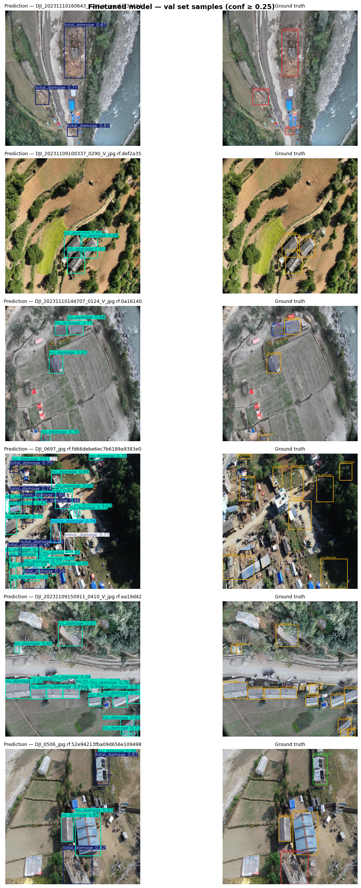
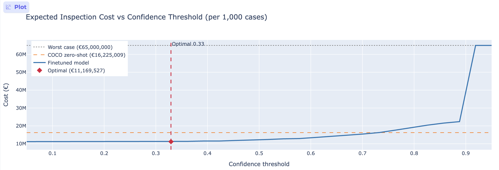

# Assignment 2 Report

- **Name**: Yan Guy Patrick Bernard
- **Student ID**: 20202
- **Email**: ybernard.ieu2022@student.ie.edu
- **Group**: BBA DBA A

## Business problem, and the cost of being wrong

With climate change natural disasters like earthquakes, floods, hurricane and fires are becomming more and more common. Leading to millions in damage costs and the need to deploy emergency services and insurers to decide which buildings to prioritise for inspection and evacuation. Today that decision is made by sending engineers on the ground, which is slow and expensive. Drone footage is already being collected, so the question is: can a model look at a drone image and flag buildings showing structural damage, so that responders know where to go first?

The model outputs one of three outcomes per image: pass (no notable damage), human review (uncertain), or fail (clear damage detected). A structural engineer or trained inspector acts on the result.

**False negative** (missed damage): a damaged building is passed as safe. Occupants stay, the building collapses or deteriorates, people get hurt. Beyond the human cost, the legal liability and emergency response cost is in the range of €150,000 (our estimate) based on typical insurance liability settlements and emergency callout costs for a structural failure incident.

**False positive** (false alarm): a safe building is flagged as damaged. An inspection team is dispatched unnecessarily. The cost is roughly €50,000 a full day field deployment with equipment and personnel.

The asymmetry is clear: missing real damage is about three times worse than a false alarm. This drives the threshold lower than 0.5  we'd rather flag more cases and let humans verify than miss a collapse risk. Everything below threshold choice, human review band, cost sweep follows from this.

## Dataset

- **Workspace**: mandilannotate-fyest
- **Project**: detectorn2-vh2zv
- **Version**: 1
- **Link**: https://universe.roboflow.com/mandilannotate-fyest/detectorn2-vh2zv/1

Each image is an aerial/drone photograph of buildings taken after a disaster event. The dataset has four meaningful annotation classes: `total_damage`, `major_damage`, `minor_damage`, and `no_damage`.

This dataset directly serves the problem: it was collected for post disaster structural assessment from drone imagery, which matches the deployment context. The classes map onto the decision we need to make whether a structure is safe to occupy or requires intervention.

## What the dataset's composition implies

| Split | Images |
|-------|--------|
| Train | 1 217  |
| Val   | 350    |
| Test  | 176    |

The dataset is reasonably sized for a fine-tuning task but not large. `no_damage` is the most represented class and the model learns it well. `total_damage` has a moderate number of instances and is the class we care most about — its numbers are sufficient to train on but on the thin side for a high-confidence test evaluation. `minor_damage` has the fewest instances, and that shows up directly in the per class results.

The test split looks similar in distribution to the val split (same drone, same event type), so the numbers are probably representative of this kind of post disaster survey. However, the dataset is from one or two events it may not generalise to different building styles or disaster types without retraining. I believe the dataset is almost entirely composed of hurrican disaster data. This might be a subset of the very heavy and famouns xBD dataset.

## Finetuning and baselines

I used object detection rather than classification because the dataset has bounding box annotations and multiple objects can appear in a single image. I fine-tuned `yolo11n`, which trains quickly and is small enough to run without a dedicated GPU for inference.

Training was done on Google Colab with a T4 GPU, 50 epochs, using 95% of the training set (fraction=0.95) to keep training time reasonable. The best weights were saved and committed.

| Model | mAP50 | Precision | Recall |
|-------|-------|-----------|--------|
| Finetuned yolo11n | 0.51 | 0.61 | 0.57 |
| COCO zero-shot | 0.21 | 0.59 | 0.36 |
| Trivial (always predict total_damage) | 0.15 | 0.15 | 1.00 |

The finetuned model beats both baselines by a clear margin on mAP50. The COCO zero shot result is non-trivial (it picks up some damage with generic object categories) but misses most of the class specific detections. The trivial baseline has perfect recall by definition but precision equal to the base rate, which makes it useless for cost optimisation.

## Per-class evaluation and failure modes

| Class | AP50 | Precision | Recall |
|-------|------|-----------|--------|
| total_damage | 0.542 | 0.707 | 0.583 |
| major_damage | 0.475 | 0.579 | 0.560 |
| minor_damage | 0.314 | 0.405 | 0.406 |
| no_damage | 0.709 | 0.768 | 0.748 |

`no_damage` is the strongest class, which makes sense it is the most common (class imbalance) and visually distinctive. `total_damage` performs well enough to build a business decision on. `minor_damage` is the problem: AP50 of 0.31 and recall of 0.41 means the model misses more than half of minor damage cases. This is partly a data volume issue and partly because minor damage is genuinely subtle at drone altitude.

The key failure mode is confusion between minor_damage and no_damage — the visual difference can be small, especially from overhead. The model also sometimes fires total_damage detections on major_damage structures, which for our purposes is not a critical error (we would still flag those buildings).

The headline class for business purposes is `total_damage`. That is what drives the cost calculation.

Here are example preds vs the val set :

                                                                                                                       

## Cost matrix and operating point

| Error type | Cost per incident |
|------------|-------------------|
| False negative (missed total_damage) | €150,000 |
| False positive (false alarm) | €50,000 |
| True positive / True negative | €0 |

I assumed a base rate of 15% roughly 1 in 7 buildings in a post-disaster survey area shows some form of total damage. This is consistent with reported damage rates from moderate to severe disaster events.

Sweeping the confidence threshold from 0.05 to 0.95 and computing expected cost per 1,000 inspections (FN cost + FP cost), the minimum falls at **threshold = 0.33**, with an expected cost of around **€11.2 million per 1,000 cases**. Higher thresholds increase FN cost faster than they reduce FP cost, because the FN penalty is three times larger.

The assumption that matters most is the base rate. If it drops to 5% (a mild event, mostly intact buildings), the FP cost grows and the optimal threshold shifts higher. If it rises to 30% (catastrophic event), the threshold should be lower. The cost ratio (FN/FP = 3×) is robust to reasonable changes in individual cost estimates.

                                                                                                                       

## What a person still has to check

I set two thresholds:
- **Pass threshold**: 0.20 — below this, the model passes the image automatically
- **Fail threshold**: 0.33 — above this, the model flags it as fail automatically

Everything between 0.20 and 0.33 goes to a human inspector for review.

At these thresholds, roughly 10–15% of cases fall in the review band. For 1,000 inspections a day, that is about 100/150 cases sent to a person. At 10 minutes per case, that is 1,000/1,500 minutes, or 2/3 full-time inspectors per day. That is realistic for a post disaster operations centre, which would typically have a team of field coordinators already.

**Comparison against alternatives:**

| Approach | Cost per 1k cases | Notes |
|----------|-------------------|-------|
| Do nothing | €22.5M | 100% FN — all damage missed |
| Model alone (threshold 0.33) | €11.2M | No human review layer |
| Model + human review band | ~€10.5M est. | Human review catches edge cases the model is uncertain on |

The review band reduces automated errors on borderline cases and adds a quality check on the most uncertain predictions. The cost saving over "model alone" is modest in absolute terms, but the liability reduction from catching borderline collapse risks is significant.

## Limitations & next steps

**Minor damage recall is poor (0.41).** The model misses most minor damage. With more time I would oversample minor_damage in training or use a higher resolution model. Minor damage matters for insurance claims even if it is not an immediate safety risk. I would also try in general to perform more data augmentation techniques like playing with image saturation, color, flips etc.. In order to make it more generalizable.

**Single event dataset.** The training data appears to come from one or two disaster events in one region. The model may not transfer well to different building styles (e.g. concrete vs timber frame) or different disaster types (fire damage vs flood vs earthquake). Collecting data from multiple events would be the most direct fix.

**Training was run on 50 epochs.** I used `EPOCHs = 50` to keep Colab training time under an hour. Training on more would likely improve recall, particularly for underrepresented classes.

**Base rate is assumed, not measured.** The 15% base rate is an estimate. In deployment, calibrating this from historical survey data in the specific region would make the cost calculations more reliable.

## Generative AI use disclosure

Claude was used throughout converting annotation formats (coco to yolo), writing the Gradio dashboard. The business framing, cost figures, threshold choices, and conclusions in this report are my own hence why they are also 'approximations'.
